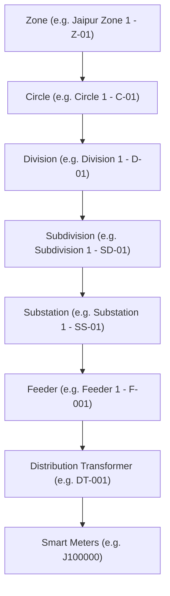

# Urja Meter Ops — Legacy Portal Protocol Analysis

This document describes the actual architecture, authentication mechanisms, network protocols, data formats, and quirks of the Urja Meter Ops portal (`https://urja-ops.flockenergy.tech`), discovered through dynamic network analysis, source inspection, and HTTP testing.

---

## 1. System Architecture Overview

The Urja Meter Ops portal is not an older multi-page PHP/JSP app as the assignment flavor text might hint, but a **SvelteKit** single-page application (SPA) with server-side rendering (SSR), hydration, and client-side routing:
- **Framework:** SvelteKit (`X-Sveltekit-Page: true`, immutable Vite-bundled chunks).
- **Authentication Framework:** `better-auth` managing session cookies (`__Secure-better-auth.session_token`).
- **Data Fetching Pattern:** A mixture of REST-like JSON endpoints under `/portal/*`, SvelteKit data endpoints (`/__data.json`), and client-side async fetch calls.

---

## 2. Authentication and Session Management

### 2.1 Login Request
- **Endpoint:** `POST https://urja-ops.flockenergy.tech/login`
- **Content-Type:** `application/x-www-form-urlencoded`
- **Payload:**
  ```text
  email=operator@urja.local&password=urja-ops-2026
  ```

### 2.2 CSRF & Origin Validation Quirk
> **CRITICAL QUIRK:** SvelteKit enforces cross-site request forgery (CSRF) protection on form actions. If an HTTP client does not send an `Origin` header matching the target host, the server immediately rejects the request:
> ```http
> HTTP/1.1 403 Forbidden
> Cross-site POST form submissions are forbidden
> ```
> **Resolution:** Any client authenticating with the portal must explicitly supply:
> `Origin: https://urja-ops.flockenergy.tech`

### 2.3 Successful Authentication Response
```http
HTTP/1.1 200 OK
Content-Type: application/json
Set-Cookie: __Secure-better-auth.session_token=<token>; Max-Age=3600; Path=/; HttpOnly; Secure; SameSite=Lax

{"type":"redirect","status":303,"location":"/meters"}
```

### 2.4 Failed Authentication Response
```http
HTTP/1.1 200 OK
Content-Type: application/json

{"type":"failure","status":401,"data":"[{\"email\":1,\"error\":2},\"operator@urja.local\",\"Invalid email or password.\"]"}
```
*(Notice: Returns HTTP 200 with an internal JSON status 401 and does not issue a `Set-Cookie` header.)*

### 2.5 Session Lifetime & Invalidation
- **Session Cookie:** `__Secure-better-auth.session_token`
- **TTL:** 3600 seconds (1 hour).
- **Sign-Out:** `POST /api/auth/sign-out` terminates the active session.
- **Unauthenticated Calls:** Submitting API requests without a session cookie returns:
  ```json
  HTTP/1.1 401 Unauthorized
  {"error":"unauthorized","message":"A valid session is required."}
  ```

---

## 3. Discovered Endpoints and Data Contracts

### 3.1 Meter Search (`/portal/meters/search`)
- **Method:** `GET`
- **Query Parameters:**
  - `q`: Search query string (matches `meterId` or `serialNo`). Empty string matches all.
  - `page`: 1-based page index.
- **Sample Request:** `GET /portal/meters/search?q=&page=1`
- **Response Format:**
  ```json
  {
    "data": [
      {
        "meterId": "J100000",
        "serialNo": "SE33962",
        "make": "HPL",
        "phaseType": "single",
        "installStatus": "Decommissioned",
        "dtCode": "DT-001"
      }
    ],
    "total": 403,
    "page": 1,
    "pageSize": 20
  }
  ```
- **Observations:**
  - Total count: exactly **403 meters**.
  - Default page size: **20 meters** per page (21 pages total).
  - Search matches substring prefixes on meter ID and serial number.

---

### 3.2 Distribution Transformers (`/portal/dts`)
- **Method:** `GET`
- **Query Parameters:**
  - `page`: 1-based page index.
- **Sample Request:** `GET /portal/dts?page=1`
- **Response Format:**
  ```json
  {
    "data": [
      {
        "code": "DT-001",
        "name": "Malviya Nagar DT 1",
        "feederCode": "F-001",
        "capacityKva": 100
      }
    ],
    "total": 40,
    "page": 1,
    "pageSize": 20
  }
  ```
- **Observations:**
  - Total count: exactly **40 distribution transformers** across 2 pages.
  - Every meter's `dtCode` refers to one of these 40 transformers.
  - Feeder codes range from `F-001` to `F-028`.

---

### 3.3 Signing Secret Retrieval (`/portal/keys`)
- **Method:** `GET`
- **Purpose:** Supplies the HMAC key used to authorize bulk export requests.
- **Response Format:**
  ```json
  {
    "data": {
      "signingSecret": "I3dZPPf5CgTp7JyGNMI8i6z8LFR7TmSR"
    }
  }
  ```

---

### 3.4 Bulk Export via HMAC (`/portal/export`)
- **Method:** `GET`
- **Query Parameters:** `page=1`
- **Required Headers:**
  - `x-timestamp`: Unix epoch in seconds (as string).
  - `x-signature`: Hex-encoded HMAC-SHA256 signature.
- **Signature Computation:**
  ```python
  payload = f"GET\n/portal/export\npage=1\n{timestamp}"
  signature = hmac.new(
      signing_secret.encode('utf-8'),
      payload.encode('utf-8'),
      hashlib.sha256
  ).hexdigest()
  ```
- **Response Format:**
  ```json
  {
    "data": [
      {
        "meterId": "J100000",
        "serialNo": "SE33962",
        "make": "HPL",
        "phaseType": "single",
        "installStatus": "Decommissioned",
        "installType": "Whole Current",
        "build": "legacy",
        "dtCode": "DT-001",
        "hierarchy": {
          "zone": { "name": "Jaipur Zone 1", "code": "Z-01" },
          "circle": { "name": "Circle 1", "code": "C-01" },
          "division": { "name": "Division 1", "code": "D-01" },
          "subdivision": { "name": "Subdivision 1", "code": "SD-01" },
          "substation": { "name": "Substation 1", "code": "SS-01" },
          "feeder": { "name": "Feeder 1", "code": "F-001" },
          "dt": { "name": "Malviya Nagar DT 1", "code": "DT-001" }
        },
        "geo": {
          "lat": 26.938961002479868,
          "lng": 75.83095696146852
        }
      }
    ],
    "total": 403
  }
  ```
- **Significance:** This single endpoint exposes the entire meter inventory, 7-level network hierarchy, and coordinates for all 403 meters in one sub-second call.

---

### 3.5 Meter Geolocation (`/portal/meters/{meterId}/geo`)
- **Method:** `GET`
- **Sample Request:** `GET /portal/meters/J100000/geo`
- **Response Format:**
  ```json
  {
    "data": {
      "latitude": "26.938961002479868",
      "longitude": "75.83095696146852"
    }
  }
  ```
- **Quirk:** Coordinates are returned as floating-point strings rather than JSON numbers.

---

### 3.6 Meter Energy Consumption (`/portal/meters/{meterId}/energy`)
- **Method:** `GET`
- **Query Parameters:**
  - `from`: Start date in `YYYY-MM-DD` format (optional).
  - `to`: End date in `YYYY-MM-DD` format (optional).
- **Default Behavior:** When omitted, returns a 7-day rolling window of 337 readings.
- **Interval:** 30-minute interval readings.
- **Sample Request:** `GET /portal/meters/J100000/energy?from=2026-06-25&to=2026-06-26`
- **Response Format:**
  ```json
  {
    "data": [
      {
        "timestamp": "25/06/2026 00:00",
        "kwh": "48459.45",
        "kvah": "52336.21",
        "voltR": "226"
      },
      {
        "timestamp": "25/06/2026 00:30",
        "kwh": "48459.87",
        "kvah": "52336.66",
        "voltR": "222"
      }
    ]
  }
  ```
- **Quirks:**
  - `timestamp` is formatted as `"DD/MM/YYYY HH:mm"` (UK/Indian format).
  - `kwh`, `kvah`, and `voltR` are strings, not numbers.
  - If date filters are invalid or out of range, returns an empty array `{"data":[]}`.

---

### 3.7 Server-Rendered Meter Details (`/meters/{id}/__data.json`)
- **Method:** `GET`
- **Payload Format:** SvelteKit devalue serialized JSON.
- **Observed Inconsistency Across Dataset:**
  - **Legacy meters (238 meters, `build: "legacy"`):** Details stored in a key-value parameter list:
    ```json
    "detail": {
      "data": [
        {"parameterName": "Meter ID", "parameterValue": "J100000"},
        {"parameterName": "Serial No", "parameterValue": "SE33962"},
        {"parameterName": "Make", "parameterValue": "HPL"},
        {"parameterName": "Phase Type", "parameterValue": "single"},
        {"parameterName": "Installation Status", "parameterValue": "Decommissioned"},
        {"parameterName": "Installation Type", "parameterValue": "Whole Current"}
      ]
    }
    ```
  - **v2 meters (165 meters, `build: "v2"`):** Details stored as a serialized JSON string in `classData`:
    ```json
    "detail": {
      "classData": "{\"installed_meter\":{\"MeterId\":\"J100004\",\"SerialNo\":\"SE65293\",\"Make\":\"Genus\",\"PhaseType\":\"single\",\"InstallationStatus\":\"Faulty\",\"InstallationType\":\"CT Operated\"}}"
    }
    ```
  - Both representations must be normalized into a single canonical model by downstream services.

---

## 4. Network Hierarchy Structure

The utility network follows a strict 7-level hierarchy:


---

## 5. Security and Operational Guidelines
1. Do not hardcode portal passwords or session tokens in git repositories.
2. Keep session tokens in memory and rotate them automatically when 401s occur.
3. Validate client date ranges before forwarding to the portal to avoid extraneous upstream traffic.
4. Utilize HMAC export caching to keep proxy latency low and protect upstream availability.
